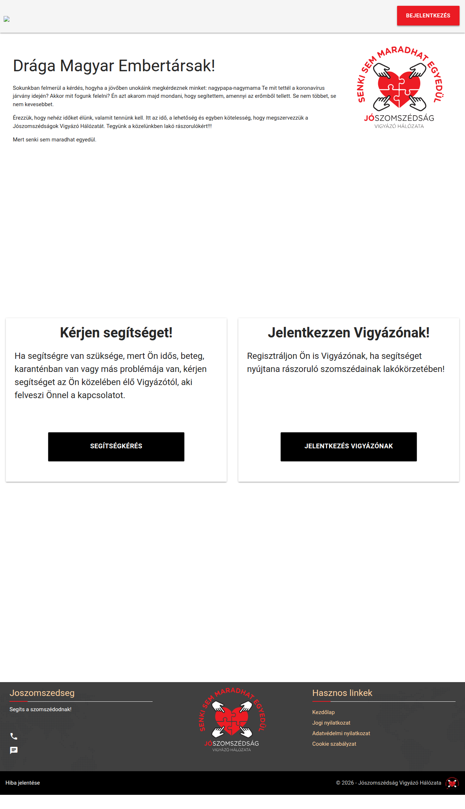
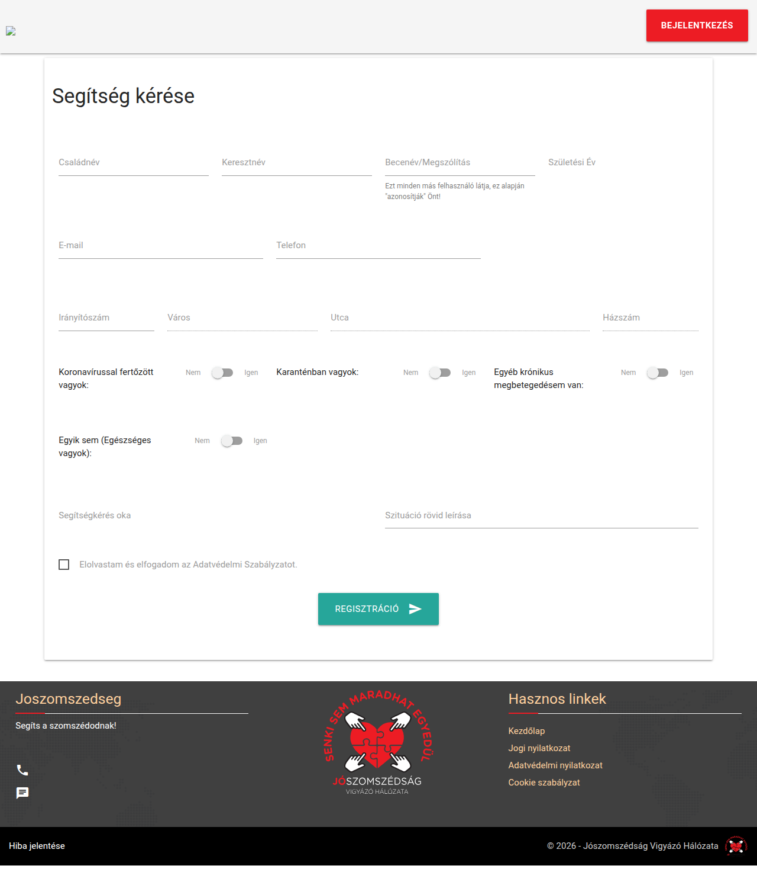
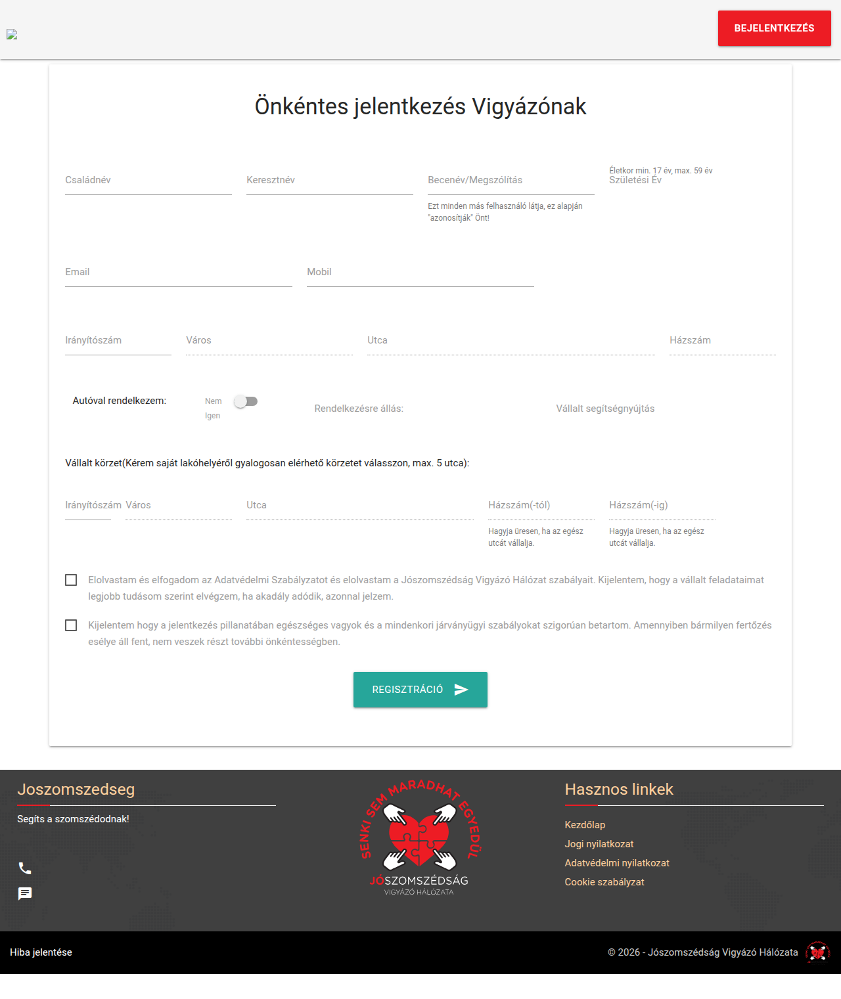
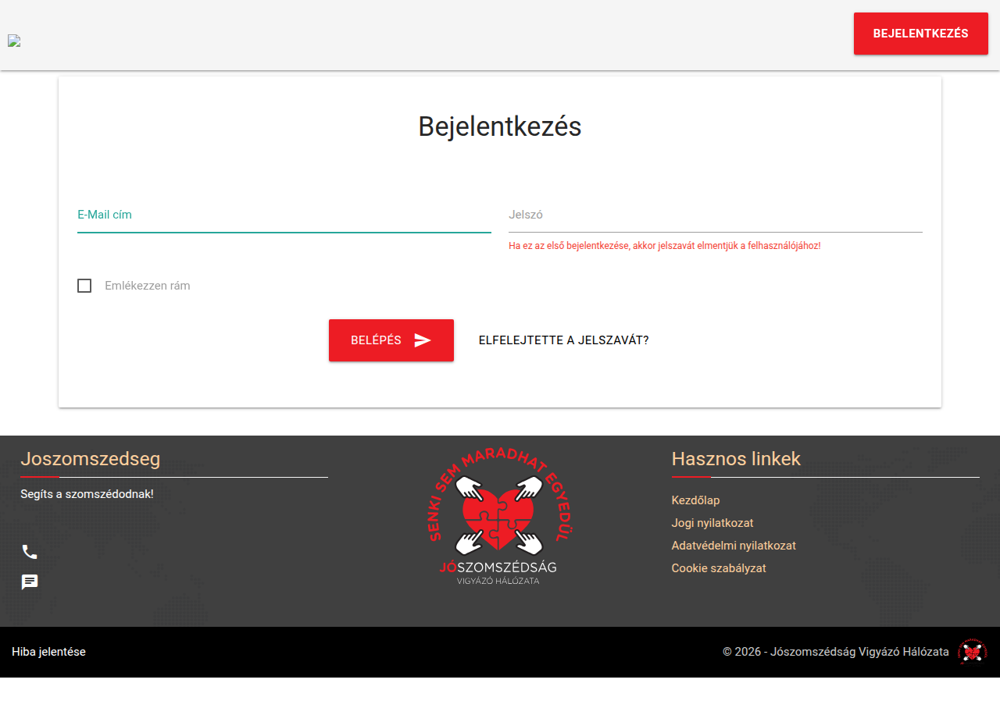
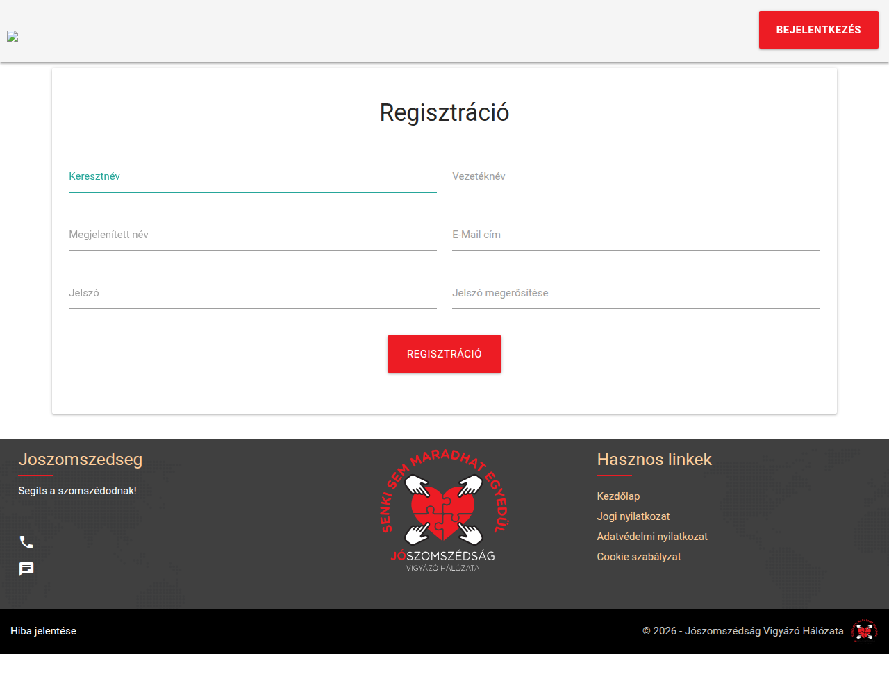

# Jószomszédság — help your neighbors

Open-source multilingual portal for neighborhood cooperation (volunteers ↔ people in need). AGPL-3.0.


## Screenshots

| Home | Help request |
|------|--------------|
|  |  |

| Volunteer registration | Login | Register |
|---|---|---|
|  |  |  |

> Screenshots are taken against a local dev-container boot with sqlite
> (`php artisan serve`, see commit). Note: the layout has a `.preloader`
> overlay that only fades on window `load`, and `load` hangs on an external
> `faviconer.net` script embedded in the preloader SVG — headed/headless
> captures must hide `.preloader` (and the `.js-cookie-consent` banner),
> e.g. via `page.addStyleTag`, otherwise shots show only the spinner.

## What it does

Hungarian neighborhood-help network: people in need post help requests, nearby
volunteers ("Vigyázók") pick them up. Matching is by **postcode + street (+ house-number range)**.

### Public (no login)

- `GET /` — landing page with help/volunteer cards.
- `GET /segitseg-keres` — help-request form (`resources/views/forms/helprequest.blade.php`).
- `GET /onkentes-regisztracio` — volunteer form (`resources/views/forms/volunteer.blade.php`); logged-in users are redirected to the dashboard.
- `POST /postcode-autocomplete` (`throttle:30,1`) — single-digit postcode prefix lookup on `cities ⨝ available_post_codes`, `LIMIT 20`, JSON.
- `POST /form-submit` (`throttle:10,1`) — creates user + address + volunteer/support rows; role whitelisted to `in:6,7` (`App\Support\RoleIds`); notifies matched volunteers (`SupportRequest` mail) and the registrant (`UserRegisteredNotification`).
- Legal pages: `/jogi_nyilatkozat`, `/adatvedelmi_nyilatkozat`, `/cookie_hasznalati_szabalyzat`.
- Bug report: `GET /hibabejelentes`, `POST /hiba_bekuldes` (`throttle:10,1`, `privacy_policy=accepted`, `desc|max:2000`, stored in `errors` table).

### Auth (laravel/ui, explicit routes — no `Auth::routes`)

Login/logout, register (`first/last/display_name/email`, password ≥ 8 + confirmed, default role Volunteer), password reset, password confirm, email verification (`MustVerifyEmail`, signed URL, `throttle:6,1` on resend). Custom notifications: `VerifyEmail`, `ResetPassword`, `WelcomeEmail`, `UserRegisteredNotification`.

### Dashboard (verified users, `/admin/*`)

- `GET /admin` — overview (`dashboard/view.blade.php`); `LayoutComposer` injects current user, role display name, home + coverage addresses, open/in-progress counts.
- `GET /admin/uj-segitsegkeres` + `POST /admin/save_support_data` — file a new request; matched volunteers are notified, status stays "new" when nobody matches.
- `GET /admin/nyitott-segitsegkeresek` — open requests, postcode-filtered (admins see all), priority 0/1/2, 3-hour hide rule.
- `GET /admin/sajat-segitsegkeresek` — tasks I volunteered for (in-progress vs. done).
- `GET /admin/leadott-segitsegkeresek` — requests I filed.
- `GET /admin/vigyazok` — volunteer directory (same postcode, admins see all); contact details hidden unless entitled.
- `GET/POST /admin/profile` — contact + home address + coverage areas; role 7→6 upgrade; deactivation releases assigned tasks with `StatusChange` mails.
- AJAX: `volunteer_for_support_ajax` (take / complete / cancel with owner/assigned/admin checks, 403 otherwise), `get_more_user_details_ajax` (PII only for owner / assigned volunteer / admin), `send_volunteer_notification_ajax` (free text ≤ 1000 chars, no sender spoofing).

### Admin-only bulk mailer (`BulkMailController`, bespoke — Voyager removed)

`GET /admin/korlevelek` (paginated list), `GET /admin/korlevelek/uj` (compose, role picker), `POST /admin/korlevelek` (`throttle:10,1`, validates `groups[] exists:roles,id`, subject ≤ 255, body ≤ 10000). Non-admins get 403. Sent via `BulkEmail` notification to users in the selected roles.

### Matching & lifecycle

`FrontIndexController@getVolunteers` / `DashboardController@getVolunteersForNewSupportRequest`: postcode + street lookup on `user_data_volunteer ⨝ addresses` with house-number range check. Request statuses (seeded `request_statuses`): 0 deleted, 1 done, 2 new, 3 in-progress, 4/5 awaiting confirmation. Scheduler (daily): `UserSupportData::cronEmails()` (1-day reminder, 2-day escalation, chunked) + `requestCompleted()` (auto-close 4/5 older than a day).

### i18n

App locale `hu` (`APP_LOCALE`, fallback `en`). `resources/lang/{hu,en}/{auth,passwords,validation,pagination}.php`; most UI strings are inline Hungarian.

### Security (see `docs/SECURITY.md`)

Bound `?` SQL everywhere; `findOrFail` + owner/assigned/admin gates (403); roles via `RoleIds` constants (Admin=1, Volunteer=6, Requester=7 — never hardcode); throttles on all public POSTs; XSS-hardened logs (`Helpers::logModelChange`/`saveLog` → `App\Log`, strip-tags + truncate, never logs secrets); `APP_DEBUG=false` default, `SESSION_HTTP_ONLY=true`.

### Operations (see `docs/OPERATIONS.md`)

`QUEUE_CONNECTION=database` default (run `queue:work --daemon` in prod; notifications fire inline otherwise). Scheduler needs `schedule:run` cron. Backups: nightly `mysqldump` + `storage/` snapshots. Watch `storage/logs/laravel.log` for 403 spikes.

## Stack

Laravel 12 (PHP 8.3 in CI/dev container), MySQL 8, Redis 6, Vite 7 + jQuery/Materialize.

> Host PHP here is 8.5 — **run PHP tooling via the `joszomszedsag-dev` container** (see AGENTS.md), or `docker compose` for runtime.

## Quickstart (native)

```bash
cp .env.example .env
composer install
php artisan key:generate
php artisan migrate --seed
npm ci && npm run build
php artisan serve
```

## Quickstart (docker)

```bash
cp .env.example .env
docker compose up --build
# app on localhost:${APP_PORT:-8080}; add joszomszedsag.local to /etc/hosts (see docker/Readme.md)
# one-shot test run: docker compose --profile test run --rm tests
```

## Configuration

Key env vars (see `.env.example`; site copy in `config/site.php` via `SITE_*`):

| Var | Default | Notes |
|-----|---------|-------|
| `APP_LOCALE` / `APP_FALLBACK_LOCALE` | `hu` / `en` | UI language |
| `DB_*` | mysql / `joszomszedsag` | compose service `mysql` |
| `QUEUE_CONNECTION` | `database` | `sync` for dev ok, `database` + worker in prod |
| `MAIL_MAILER/HOST/PORT` | `smtp` / `127.0.0.1` / `1025` | Mailpit in dev |
| `SESSION_SECURE_COOKIE` | `false` | set `true` behind HTTPS |
| `SITE_TITLE/DESCRIPTION/LOGO` | Jószomszédság… | replaces removed Voyager settings table |
| `SITE_ORG_NAME/SLOGAN/ADDRESS/PHONE/EMAIL` | — | footer/contact copy |
| `APP_PORT` / `DB_EXPOSE_PORT` | `8080` / `33060` | compose port mapping |

Production checklist: `APP_ENV=production`, `APP_DEBUG=false`, fresh `APP_KEY`, unique `DB_PASSWORD`, `SESSION_SECURE_COOKIE=true`.

## Testing / lint

```bash
docker run --rm -v .:/app -w /app joszomszedsag-dev vendor/bin/phpunit --coverage-text
find app routes database -name '*.php' -print0 | xargs -0 -n1 php -l
npm ci && npm run build
npm run lint && npm audit --audit-level=high
```

CI (`.github/workflows/ci.yml`) runs all of the above on PHP 8.3 + Node 20 and fails under 50% line coverage.

### Coverage (measured 2026-10-26, PHP 8.3 + pcov, sqlite `:memory:`)

**38 tests, 147 assertions — OK. Lines 69.5% (734/1056), Methods 49.3% (67/136), Classes 28.9% (11/38).**

| Suite | File | What it covers |
|-------|------|----------------|
| Feature | `AuthFlowTest` | login page, login, unknown email, first-login password adoption, logout |
| Feature | `BulkMailTest` | non-admin 403, admin list/create/send, group validation |
| Feature | `DashboardFlowTest` | dashboard renders, guest redirect, save profile, save support data, take/release flow |
| Feature | `NotificationsTest` | all mail notifications render, notification sent on take |
| Feature | `PostcodeAutocompleteValidationTest` | missing/injection/two-digit prefixes rejected, valid prefix JSON |
| Feature | `PublicPagesTest` | public pages render, logged-in redirect, error-report validation |
| Feature | `RegistrationFlowTest` | volunteer + support registration, unmatched status, bad email |
| Feature | `RegistrationValidationTest` | invalid/missing role rejected |
| Feature | `SchedulerTasksTest` | auto-close stale confirmations, cron-email skips |
| Feature | `VolunteerAuthorizationTest` | guest blocked, unknown status/record rejected, stranger PII blocked |
| Unit | `HelpersTest` | log XSS/secret stripping, postcode contract |
| Unit | `RoleIdsTest` | registration roles = volunteer + requester |

Known gaps (no dedicated test): password reset/confirm flow, email verification resend, legal/error page rendering beyond smoke tests, some admin AJAX edge cases.

## Project structure

```
app/Http/Controllers/      FrontIndex (public forms), Dashboard, BulkMail, Auth/*, Legal, Error
app/Http/View/Composers/   LayoutComposer (dashboard shared data)
app/Notifications/         VerifyEmail, ResetPassword, WelcomeEmail, UserRegistered, SupportRequest, StatusChange, ...
app/Support/RoleIds.php    role constants — never hardcode 1/6/7
resources/views/           layout, welcome, forms/*, auth/*, dashboard/**, legal/*, partials/*
resources/js|sass/         Vite 7 ESM + sass (build output public/build is gitignored)
routes/web.php             all routes (web-only, no api.php) — ~38 endpoints
database/migrations|seeders  users, roles (1/6/7), addresses, volunteer/support data, help_types, cities, bulk_mails, logs
tests/                     10 Feature + 2 Unit (phpunit.xml, sqlite memory)
docs/                      SECURITY.md, OPERATIONS.md, UPGRADE-PLAN.md, screenshots/
docker/                    build/ (runtime PHP 8.3), dev/ (joszomszedsag-dev test image)
```

## Docs

- `AGENTS.md` — contributor/agent guide (read first).
- `BACKLOG.md` — full refresh backlog (P0–P3 done, MOD-01…06 done).
- `docs/SECURITY.md` — reporting, threat model, operator checklist.
- `docs/OPERATIONS.md` — queue, scheduler, backups.
- `docs/UPGRADE-PLAN.md` — Laravel 12 upgrade record.
- `docker/Readme.md` — `joszomszedsag.local` host setup.

## Project

- Why/what/who: neighborhood self-organization, elders, families, single parents.
- Contribute: UX/UI, web dev, testers, translators — see BACKLOG P4 for i18n plans.

## License

AGPL-3.0 — see https://www.gnu.org/licenses/agpl-3.0.en.html
